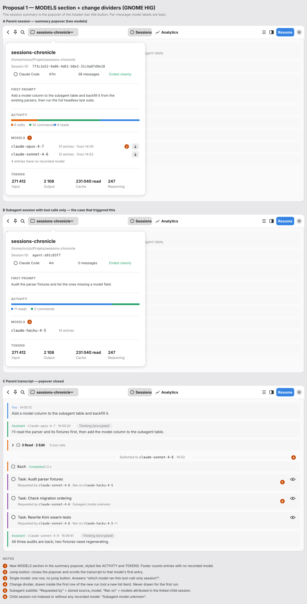
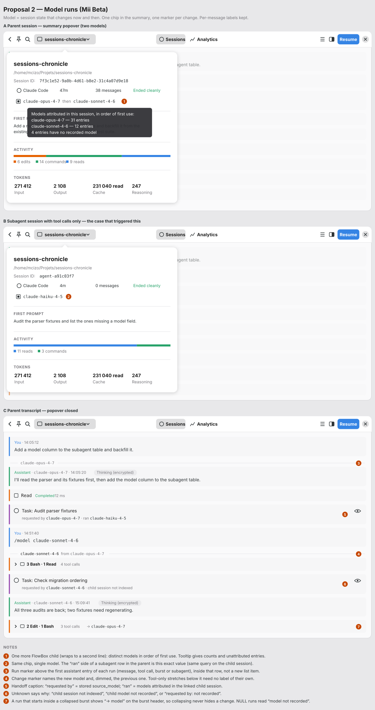
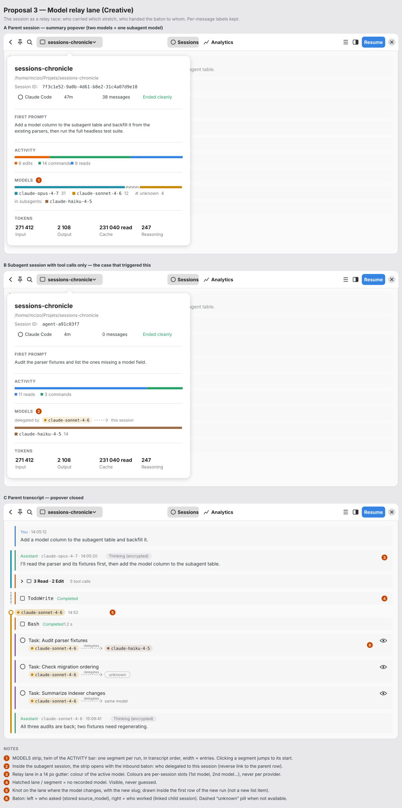

# Display Model Attribution for Tool Calls and Subagents — Design Exploration

**Date**: 2026-10-25  
**Feature**: Surface the model behind every assistant entry (messages, tool calls, subagents) in the session view  
**Prerequisite**: [Model storage for assistant transcript entries](../superpowers/specs/2026-10-20-assistant-entry-model-storage-design.md) (`ToolCall.model`, `Subagent.source_model`, schema v23)  
**Previous work**: [Display LLM Model in UI](2026-02-24-model-display-exploration.md) (per-message inline caption, shipped)  
**Mockups**: `docs/mockups/assistant-entry-model-display/`  

---

## The Problem

A subagent session that contains **only tool calls** gives no way to know which
model ran it. The message header shows the model today, but such a session has no
assistant message at all, so the information never reaches the screen.

The storage spec fixes the data side: every tool call and subagent row will carry
its originating model. This exploration decides where to show that information.

What the user said matters:

- For the session that triggered this, **a session-level answer in the summary
  would have been enough**.
- **Model changes during a session** must still be visible somewhere. A single
  label in the summary cannot say *where* Opus handed over to Sonnet.
- On a **subagent row** in the parent transcript, show **both models with a clear
  distinction**: the model that delegated and the model that actually ran the
  subagent.

## Technical Context

### Available data (after the storage spec lands)

| Entry kind | Field | Meaning |
|---|---|---|
| Assistant message | `Message.model` | Model that generated the message (already displayed) |
| Reasoning | `ReasoningAttachment.source_model` | Model of the reasoning block |
| Tool call | `ToolCall.model` | Model that **requested** the call, not the program executing it |
| Subagent | `Subagent.source_model` | Model of the **parent** that delegated |
| Context entry | — | No model, by design |

The **subagent's own model** is not stored on the subagent row. It can be
derived from the linked child session (`subagents.child_session_id`) by
aggregating the models attributed to the child's own entries. When the child is
not indexed, or none of its entries carry a model, it is unknown. A model
requested in the call arguments (Claude Code `input.model`, Kimi
`subagent_type`) is a different value and must not be shown as "ran on".

### Current UI

- **The session summary is a popover**, opened from the session title button in
  the header bar (`session_detail.rs`, `summary_popover`). It contains
  (`session_summary.rs`): project name, path, session ID, a flat chip
  `gtk::FlowBox` with up to 4 children per line (assistant, duration, message
  count, ending status), then FIRST PROMPT, ACTIVITY (a thin stacked bar with a
  legend), and TOKENS. **No model anywhere.**
- Assistant message header: `Assistant · claude-opus-4-7 · 14:32:05`
  (`row_rendering.rs::model_label_text`), repeated on every assistant message.
  **This label is kept in every proposal** (decision of 2026-10-25).
- Tool-call row header (`tool_call_row.rs`): icon, monospace name, status,
  duration, optional Thinking pill.
- Tool burst (`typed_row.rs::rebuild_tool_burst_header`): category pills in an
  `adw::WrapBox`, collapsible.
- Subagent row (`typed_row.rs::build_subagent_page_content`): agent icon, title,
  optional Thinking pill, inspect button. Single line.
- The transcript is a virtualized `GtkListView`. The whole item list is loaded
  up front (`load_all_transcript_items`), so per-item state derived from
  neighbours can be computed once when item inits are built.

### Invariants all proposals respect

- **Unknown stays unknown.** A missing model is never filled from a neighbour,
  the session, or the subagent's requested model (spec rule 4).
- **Full slugs, no aliases.** No `sonnet-4-6` shortening, no provider guessing,
  no colour-by-provider (spec rule 5). The February exploration already found
  slug heuristics fragile.
- **No new transcript item kind.** A model-change marker lives *inside* the row
  that starts the new run. Inserting a separate list item would shift item
  indices used by search-match navigation, inspector routing, and scroll
  restoration.
- **The tool-call row header stays model-free.** Printing the same slug on every
  `Read`/`Edit`/`Bash` is noise. All three proposals agree on this.

### Shared building blocks

Every proposal needs the same two pieces of data:

1. **`session_models(session_id)`**: distinct attributed models in first-use
   order, with an entry count each, plus a count of unattributed assistant
   entries. Source rows: `messages.model` (assistant role),
   `tool_calls.model`, `subagents.source_model`. This feeds the summary and,
   called on the child session, the "ran on" side of a subagent row.
2. **Run boundaries**: walking the ordered transcript items, mark each entry
   whose attributed model differs from the previous attributed entry. Computed
   while building item inits (`model_run: Option<ModelRunMarker>`), only shown
   or hidden in `bind`.

---

## Proposal 1 — MODELS Section + Change Dividers (GNOME HIG)

**Mockup** (A: parent session popover, B: tool-call-only subagent session,
C: parent transcript):

### Description

Standard libadwaita vocabulary only. Three surfaces:

1. **Summary popover: a MODELS section** placed between ACTIVITY and TOKENS,
   with the same caption style.
   - One row per model: full slug, entry count, time of first use, and a small
     jump button that closes the popover and scrolls the transcript to that
     model's first entry.
   - A footer line counts entries with no recorded model.
   - Single model (panel B, the tool-call-only subagent session from the
     user's story): one row, no jump button.
   - Hidden when no entry has a recorded model.
2. **Transcript: change dividers.** A centred caption between two separators,
   `Switched to claude-sonnet-4-6 · 14:52`, drawn at the top of the first entry
   whose attributed model differs from the previous known one. Nothing is drawn
   for the first run: the summary already names it.
3. **Subagent row: a two-line row**, title plus subtitle, in the
   `AdwActionRow` idiom:
   `Requested by claude-sonnet-4-6 · Ran on claude-haiku-4-5`.
   - Child not indexed or no model recorded: `Subagent model unknown`.
   - Child used several models: `Ran on claude-haiku-4-5 +1`, full list in the
     tooltip.

A model chip in the chip FlowBox was considered first. It was dropped because
the summary is already a popover: a multi-model breakdown would need a popover
inside a popover, and a fifth FlowBox child wraps alone onto a second line.

### Widget structure

- MODELS section: a `gtk::Box` with the existing section caption label and one
  horizontal `gtk::Box` per model (`gtk::Label.monospace`, `gtk::Label.dim-label`,
  `gtk::Button.flat.circular` with `go-down-symbolic`). The button emits a
  `ScrollToItem` message and pops the popover down.
- Divider: a horizontal `gtk::Box` (`gtk::Separator` / `gtk::Label.caption` /
  `gtk::Separator`), prepended inside the row's root and hidden by default.
- Subagent subtitle: a `gtk::Label` with `caption` and `dim-label` in a new
  vertical box around the existing title row; slugs wrapped in `<tt>` markup.

### HIG compliance

- **Progressive disclosure**: the header-bar popover already holds secondary
  session information; the MODELS section extends it without a new surface.
- **Consistency**: same caption, spacing, and separators as ACTIVITY and TOKENS.
- **Separators with captions** for state changes in a timeline match how
  Fractal and Polari show room events.
- **Title + subtitle rows** reuse the `AdwActionRow` reading pattern users
  already know.

### Pros

- Answers the user's case directly in the existing summary, and stays quiet for
  single-model sessions (one row, zero dividers).
- The jump buttons add **navigation** ("take me to where Sonnet took over").
- Lowest regression risk; no custom colours, so light, dark, and high-contrast
  themes work for free.

### Cons

- Assistant messages show the slug on every header while tool calls in the same
  run show nothing. The divider makes up for this, but the treatment is not
  uniform.
- A centred divider spends a full line of vertical space per change. Kimi
  sessions that alternate models often would get many of them.
- "Subagent model unknown" does not say *why* (not indexed vs not recorded).

---

## Proposal 2 — Model Runs (Mii Beta)

**Mockup** (A: parent session popover, B: tool-call-only subagent session,
C: parent transcript):

**Thesis**: a model is session *state* that changes now and then, not a per-row
property.  
**Surfaces touched**: summary chip FlowBox (+1 chip), row headers (+1 optional
marker), subagent row (+1 caption line).  
**Per-message label**: kept (Mii Beta originally proposed removing it; the user
chose to keep it).  

### Description

Storage attributes a model to every entry, but on screen that value stays the
same for dozens of entries in a row. Printing it on each tool call would make
the slug wallpaper, and the one moment that matters (the switch) would look
like every row around it. So the proposal run-length encodes the model:

1. **Summary popover: one model chip**, an extra FlowBox child that wraps to a
   second line, listing distinct models in first-use order:
   `claude-opus-4-7 then claude-sonnet-4-6`. A tooltip gives per-model entry
   counts and the unattributed count. Hidden when nothing is attributed.
2. **Transcript: run markers.** A thin labelled rule above the first assistant
   entry of each run (message, tool call, burst, or subagent). The first marker
   names the model. Later markers name the new model and, dimmed, the previous
   one (`claude-sonnet-4-6 from claude-opus-4-7`). Tool calls inside a run
   carry no slug.
3. **Subagent row: handoff caption.** A second line with literal verbs:
   `requested by claude-opus-4-7 · ran claude-haiku-4-5`. "Ran" is exactly
   `session_models(child)`, the same function as the summary chip.

### Widget structure

- Summary chip: one more FlowBox child; slugs as `gtk::Label.monospace`,
  "then" as `dim-label`, tooltip text from `session_models`.
- Run marker: `gtk::Box.model-run-marker` (leading `gtk::Separator`,
  `caption monospace` label, optional `caption dim-label` "from …", trailing
  hexpand `gtk::Separator`), prepended inside the row's root.
- Bursts: if a run starts inside a **collapsed** burst, the burst header shows
  `→ claude-opus-4-7` so collapsing never hides a transition. Expanded, the
  marker sits on the child row.
- Handoff caption: the subagent root becomes vertical, with the existing title
  row unchanged plus a caption row. The child-model lookup runs on the
  background loading path and is cached per child.
- CSS: only `.model-run-marker`. No palette.

### Behaviour

- **Single model**: one chip, exactly one marker above the first assistant
  entry.
- **Several models**: one marker per change, including switching back
  (Opus → Sonnet → Opus gives three markers). Kimi steps and Vibe
  `model_change` checkpoints fall out of the same rule.
- **All unknown**: no chip, no markers, no "Unknown model" filler.
- **Unknown in the middle**: NULL is a value of its own. Known → NULL draws a
  "model not recorded" marker, so an unattributed stretch never appears to
  inherit the previous model.
- **Subagent unknowns say why**: `child session not indexed`,
  `child model not recorded`, or `requested by: not recorded`.
- **Resumed subagents and swarms**: each row shows its own `source_model`;
  rows sharing a child show the same "ran" value.

### Accessibility

Markers are not focusable. Their text becomes the row's accessible description
("Model changed to claude-sonnet-4-6 from claude-opus-4-7"), so screen-reader
users hear the transition where it happens. The handoff caption joins the
subagent row's accessible label.

### Pros

- Changes become visible instead of blending in, with very little added text.
- Labels map one-to-one to storage: "requested by" = `source_model`, "ran" =
  child entries, "not recorded" / "not indexed" = NULL / no link.
- One aggregate function feeds both the chip and the "ran" side.
- Handles collapsed bursts and NULL stretches explicitly.

### Cons

- With the per-message label kept, the first marker repeats what the first
  assistant header already says.
- The chip's per-model counts live in a tooltip: not discoverable, not
  available on touch.
- `then` chains get long with three or more models.
- Burst headers gain one more conditional label.

---

## Proposal 3 — Model Relay Lane (Creative)

**Mockup** (A: parent session popover, B: tool-call-only subagent session,
C: parent transcript):

### Description

Treat the session as a **relay race**: each model carries the work for a
stretch, then hands the baton over, sometimes to a subagent. The model becomes
a *place* on a timeline rather than a label on rows.

1. **Summary popover: a MODELS strip**, the twin of the ACTIVITY bar, placed
   right below it.
   - A thin segmented bar: one segment per run, in transcript order, width
     proportional to the entry count. Unattributed runs are **hatched**.
   - A legend in the ACTIVITY style (`■ claude-opus-4-7 31 · ■ claude-sonnet-4-6 12 · unknown 4`),
     plus models seen only in subagents (`in subagents: ■ claude-haiku-4-5`).
   - Clicking a segment closes the popover and scrolls to the start of that run.
2. **Transcript: a relay lane.** A 4 px vertical line in a 14 px gutter left of
   the rows, coloured by the active model. Hatched where entries have no model.
   At each change, a **knot** on the lane with a tag `● claude-sonnet-4-6 14:52`
   instead of a full-width divider.
3. **Subagent row: a baton.**
   `[● claude-sonnet-4-6] ⇢ delegates ⇢ [● claude-haiku-4-5]`. Direction carries
   the meaning: left = who asked, right = who worked. Unknown child: a dashed
   `unknown` pill. Same model on both sides: `same model`.
4. **Inside the subagent session** (panel B, the user's story), the MODELS
   section opens with the inbound baton (`delegated by ● claude-sonnet-4-6 ⇢ this session`),
   so the session answers both "who ran me" and "who asked me".

### Colour rule

Colours are **per-session ordinals, not providers**: the first model seen in
the displayed session gets slot 1, the next slot 2, and so on, from GNOME
accent colours (teal, yellow, brown, pink, slate). They avoid the semantic hues
already in use: blue (user role, reads), green (assistant role, commands),
orange (tool call, edits), purple (subagent), red (error). Child models seen on
baton pills take the next free slot. No slug parsing, so spec rule 5 still
holds. Colour is never the only channel: the legend, the knot tags, and the
baton pills always print the full slug.

### Widget structure

- MODELS strip: reuses the ACTIVITY bar widget with model segments; one
  `gtk::Button.flat` overlay per segment for click-to-jump; legend in an
  `adw::WrapBox`.
- Lane: drawn by each row in its own left margin (a 4 px `gtk::Box` with a
  CSS class per slot), so long runs look continuous without a cross-row
  overlay.
- Knot tag: prepended inside the first row of the new run, like the markers of
  the other proposals.
- Baton: two `gtk::Box.pill` with a dashed arrow between them.

### Pros

- **Most scannable**: the whole model history is visible in the summary at a
  glance, and the lane tells you the active model wherever you land in the
  transcript, even from a search hit, without scrolling up.
- The MODELS strip reuses a visual the user already reads (ACTIVITY).
- The baton gives the strongest **who-asked / who-worked** distinction of the
  three, and the inbound baton closes the loop from the child side.
- Unknown is *visible*: a hatched stretch says "we don't know".

### Cons

- **Non-standard**: a gutter lane and slot colours depart from stock
  libadwaita. Needs high-contrast tuning.
- The gutter narrows every row and adds a second colour edge next to the
  existing role borders.
- Slot colours are not stable *across* sessions: Sonnet can be yellow in one
  session and teal in the next.
- The inbound baton needs a reverse lookup (child → parent subagent row) that
  the UI does not do today.
- The largest implementation of the three.

---

## Shared Risks

- **Partially reindexed databases.** Right after the v23 migration, messages
  have a model while tool calls and subagents are NULL until their source is
  reparsed. Run detection would then draw known → unknown → known flicker on
  every tool burst. Mitigation (from Proposal 2): if a session has message
  models but **no** attributed tool calls or subagents, treat NULL tool calls
  and subagents as "pre-attribution" and draw no markers for them. It needs a
  test.
- **Sources that cannot be reparsed** stay NULL forever. All proposals must
  degrade to "no information" rather than error states.
- **Child-model lookup cost**: one aggregate per subagent row with a linked
  child. It is cheap with the `session_id` index but must stay off the main
  thread and be cached per child.

---

## Comparison

| Criterion | 1. HIG section + dividers | 2. Model runs (Mii Beta) | 3. Relay lane (Creative) |
|---|:---:|:---:|:---:|
| Answers the tool-call-only session | ★★★★★ | ★★★★★ | ★★★★★ |
| Shows where models change | ★★★★☆ | ★★★★★ | ★★★★★ |
| Active model visible anywhere you land | ★★★☆☆ | ★★★☆☆ | ★★★★★ |
| Who-asked / who-worked distinction | ★★★★☆ | ★★★★☆ | ★★★★★ |
| Explains *why* unknown | ★★☆☆☆ | ★★★★★ | ★★★☆☆ |
| Summary readability (no hover needed) | ★★★★★ | ★★★☆☆ | ★★★★★ |
| Visual noise | ★★★☆☆ | ★★★★★ | ★★★☆☆ |
| HIG / stock widgets | ★★★★★ | ★★★★☆ | ★★☆☆☆ |
| Implementation effort (lower = more stars) | ★★★★☆ | ★★★★☆ | ★★☆☆☆ |

_(★★★★★ = best / ★☆☆☆☆ = worst)_

### Possible hybrid

**Proposal 1's MODELS section in the summary popover + Proposal 2's transcript
treatment.**

- Summary: the MODELS section with jump buttons (Proposal 1) instead of the
  chip and its tooltip. It fits the popover, needs no hover, and gives
  navigation.
- Transcript: Proposal 2's thin run markers instead of full-width dividers,
  including the collapsed-burst `→ model` hint and the explicit
  "model not recorded" marker.
- Subagent row: Proposal 2's handoff caption and its "why unknown" strings.
- Later, optionally: Proposal 3's segmented bar inside the MODELS section,
  without the transcript lane.

---

## Decision

**Pending confirmation.** Already decided: the per-message model label is kept.

Recommendation: **the hybrid above.**

Rationale:

- It answers the triggering case (a tool-call-only subagent session) in the
  summary popover, which the user said was enough, with a section that looks
  like the ones already there.
- Model changes are marked by one rule shared by every entry kind, at the cost
  of a thin rule instead of a full divider.
- The subagent handoff caption gives the "both models, clearly distinguished"
  that was asked for, with labels that map exactly to what is stored and to
  what is merely derived.
- Stock GTK widgets and one CSS class.

## Next Steps

1. Confirm the hybrid (or pick a single proposal).
2. Write the design spec in `docs/superpowers/specs/`.
3. Plan the implementation with `writing-plans`, after the storage spec has
   landed.
